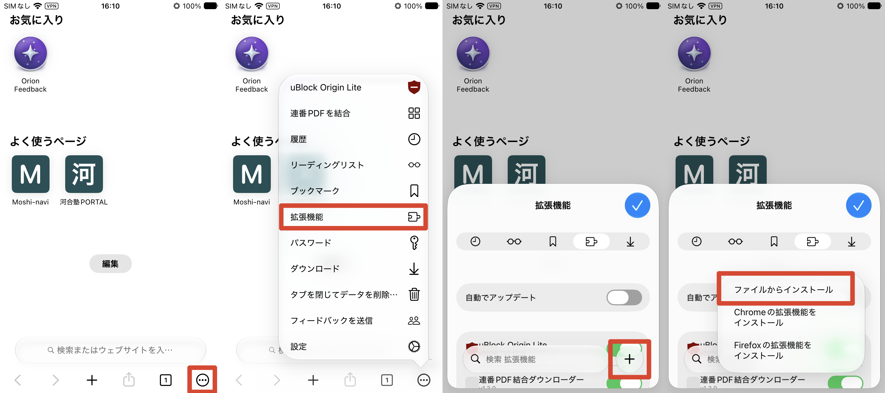
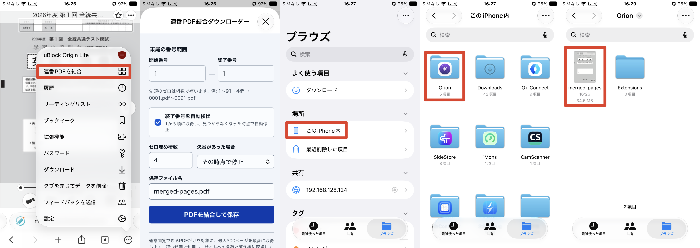

# 連番PDF結合ダウンローダー

河合塾の「学習の手引き」で使われている連番PDFを、1つのPDFへ結合して保存するブラウザ拡張機能です。

次のような「学習の手引き」ページ、またはその中で表示されるPDFに対応しています。

```text
https://moshi-navi.kawai-juku.ac.jp/tebiki/<年度>/<教材ID>/book/index.html#target/page_no=1
https://moshi-navi.kawai-juku.ac.jp/tebiki/<年度>/<教材ID>/book/index.html#target/page_no=3
https://moshi-navi.kawai-juku.ac.jp/tebiki/<年度>/<教材ID>/book/pdf/0001.pdf
https://kawaijuku.meclib.jp/library/books/<教材ID>/book/pdf/0001.pdf
```

上記はURLの構造を示すためのプレースホルダーです。実在する教材IDや、直接アクセスできる教材・PDFのURLはソースコードおよびREADMEに収録していません。`<年度>`と`<教材ID>`を文字どおり入力するものではありません。

`page_no=1`だけでなく、`page_no=2`、`page_no=3`などを表示している状態でも拡張機能を開けます。終了番号の自動検出を使う場合は、現在表示しているページ番号に関係なく`0001.pdf`から順番に取得します。

## 動作確認環境

- macOS / Linux / Windows: ChromeおよびChromiumベースのブラウザ
- Android: 拡張機能のインストールに対応したChromiumベースのブラウザ
- iPhone / iPad: Orion Browser by Kagi

Android版Chrome本体は通常の拡張機能を読み込めないため、[Titanium](https://play.google.com/store/apps/details?id=io.github.jqssun.helium)など、拡張機能のインストールに対応したブラウザが必要です。

iPhone / iPadでは、[Orion Browser by Kagi](https://apps.apple.com/jp/app/orion-browser-by-kagi/id1484498200)を使用してください。

## インストール方法

### macOS / Linux / Windows / Android

1. 配布されたZIPを解凍します。
2. 拡張機能に対応したブラウザを開きます。
3. ブラウザの設定から「拡張機能」を開きます。
4. 右上の「デベロッパーモード」をオンにします。
5. 「パッケージ化されていない拡張機能を読み込む」を押します。
6. ZIPを解凍してできたフォルダを選択します。

ブラウザによって項目名が少し違う場合がありますが、「拡張機能」「デベロッパーモード」「パッケージ化されていない拡張機能を読み込む」に相当する項目を使用してください。

### iPhone / iPad（Orion）

iPhone / iPadではZIPを解凍しません。受け取ったZIPファイルをそのままOrionへ読み込みます。

1. Orion右下の`…`を押します。
2. 「拡張機能」を押します。
3. 右下の`＋`を押します。
4. 「ファイルからインストール」を押します。
5. 配布されたZIPファイルを選択します。



## 使い方

1. 河合塾の「学習の手引き」、または「学習の手引き」のPDFを表示します。
2. そのページを表示したまま拡張機能を開きます。
3. 開始番号・終了番号・ゼロ埋め桁数を確認します。
4. 必要に応じて保存ファイル名を変更します。
5. 「PDFを結合して保存」を押します。

「終了番号を自動検出」をオンにすると、`1`から順番にPDFを取得し、次のPDFが見つからなくなった時点で停止します。URLの`page_no`が`2`や`3`でも、自動検出は必ず`1`から開始します。

同じ名前のPDFがすでに保存先にある場合は、既存ファイルを上書きせず、ブラウザが`ファイル名 (1).pdf`、`ファイル名 (2).pdf`のように番号を付けます。

### iPhone / iPadでの保存

Orionでは結合完了後に、指定したファイル名が表示された保存ボタンが出る場合があります。そのボタンをもう一度タップしてください。これは`Undefined`やランダムなUUIDをファイル名に使われないよう、実際のタップ操作で保存を開始するためです。

保存したPDFは、ファイルアプリの次の場所にあります。

```text
このiPhone内 または このiPad内
└ Orion
  └ 指定したファイル名.pdf
```



## 保存場所

- macOS / Linux / Windows / Android: ブラウザのダウンロードフォルダ
- iPhone / iPad: ファイルアプリの「このiPhone内」または「このiPad内」→「Orion」フォルダ

## ファイル名について

保存ファイル名欄で指定した名前を使用します。`.pdf`を入力しなかった場合は自動的に追加されます。

ファイル名に使用できない`/`、`\\`、`:`、`*`、`?`などの文字は、自動的に`_`へ置き換えます。

## 注意事項

- 本拡張機能は、利用者本人がブラウザ上で通常閲覧できるPDFだけを対象にしています。認証やアクセス制限を回避する機能はありません。
- 一度に結合できるのは最大300ファイルです。サイトへ過剰な負荷をかけないよう、必要な範囲だけ取得してください。
- PDF以外の応答、暗号化されたPDF、破損したPDFは結合できません。
- iPhone / iPadでは処理中や保存待ちの状態で拡張機能の画面を閉じると、処理結果が失われる場合があります。
- ダウンロードしたPDFを、権利者の許可なく他人へ送信、共有、再配布、公開しないでください。私的使用の範囲を超える共有・配布は著作権法違反となる場合があります。
- 教材、解答、解説の著作権、サイトの利用規約、学校や予備校から指定された利用範囲を守ってください。

## 開発・テスト

依存ライブラリの`pdf-lib`は`lib/pdf-lib.min.js`に同梱しているため、実行時に外部CDNからコードを読み込みません。

```bash
npm test
```

URL解析、`page_no=2`以降の認識、ゼロ埋め、自動検出の開始番号、保存ファイル名の正規化などをテストします。

## ライセンス

本プロジェクトはGNU General Public License v3.0以降（GPL-3.0-or-later）の下で公開されています。詳細は[LICENSE](LICENSE)を参照してください。

Copyright (C) 2026  tqmane

このプログラムは有用であることを期待して配布されますが、**完全に無保証**です。商業性や特定目的への適合性の黙示の保証も含め、一切の保証はありません。詳細はGNU General Public Licenseをお読みください。

このプログラムと一緒にGNU General Public Licenseの写しを受け取っているはずです。受け取っていない場合は、<https://www.gnu.org/licenses/>を参照してください。
